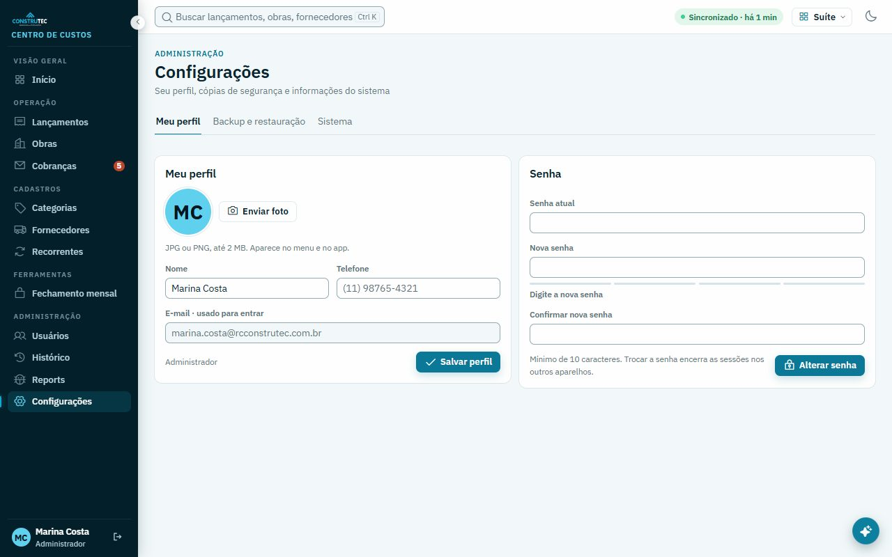

# C3 — Reports e Configurações

Issue #134 · branch `feat/telas-c3` · base `7344c0f` · 14/10/2026.

**Entrega completa.** Código pelo Codex; capturas, suíte completa, commit e PR pelo orquestrador (Claude Code), porque o sandbox do Codex bloqueava `spawn` (Chrome e `node --test`). Sem publicação nem alteração de backend/banco.

## Resultado após os ajustes (orquestrador, 14/10)

- Kit C3: **66/66 capturas** (11 estados × 1280x720, 1280x800, 1440x900 × claro/escuro), **0 com erro, aviso, rolagem horizontal, rolagem aninhada ou corte** ([resultado.json](evidencias/resultado.json)). 44 capturas versionadas em `evidencias/depois/` (1280x720 e 1280x800).
- `npm test`: **517/517**.
- `npm run check`: 274 arquivos.


## Ajustes implementados

- Reports: busca e filtros próximos, como na Referência; quebra de títulos longos sem espaços.
- Perfil: ações de foto e instrução agrupadas ao lado do avatar, como no print 90. Mantidos seletores, upload, remoção de foto e textos.
- Senha: o contêiner de erro vazio não ocupa espaço antes do primeiro campo; reaparece quando há mensagem.
- Configurações: intervalos dos cartões e abas ajustados às medidas do protótipo; removida margem redundante abaixo das abas. Aba ativa usa a cor de destaque da Referência.

Removidos: **nenhum controle, texto funcional ou recurso**. Nenhuma função nova de negócio.

## Evidências disponíveis e limites

A inspeção usou os prints D7 do C1 já versionados e o HTML `docs/suite-desktop/prototipo/Desktop.dc.html`. As imagens abaixo são anteriores ao C3; **não são capturas desta execução nem prova do resultado após os ajustes**.

| Tela | App anterior (C1) | Referência |
|---|---|---|
| Reports | [1280×800 claro](../D7/1280x800-claro-reports.jpg) | [Print 80](../../prints/80-reports.jpg) |
| Novo report | [1280×800 claro](../D7/1280x800-claro-report-novo.jpg) | [Print 81](../../prints/81-report-novo.jpg) |
| Perfil | [1280×800 claro](../D7/1280x800-claro-config-perfil.jpg) | [Print 90](../../prints/90-config-perfil.jpg) |
| Backup | [1280×800 claro](../D7/1280x800-claro-config-backup.jpg) | [Print 93](../../prints/93-config-backup.jpg) |
| Sistema | [1280×800 claro](../D7/1280x800-claro-config-sistema.jpg) | [Print 95](../../prints/95-config-sistema.jpg) |




O Chrome headless não respondeu ao DevTools Protocol nas tentativas pelo kit e pelo PowerShell. Uma tentativa de diagnóstico com `spawn` retornou `EPERM`. O kit não produziu prints novos. Não foram usados navegador compartilhado, conta real ou serviço externo.

## Validação

- `npm run check`: **274 arquivos JavaScript verificados**, inclusive após os ajustes funcionais de markup/CSS.
- `node --check scripts/conferencia/c3.js` e `c3-isolamento.js`: passaram.
- `git diff --check`: passou.
- `npm test -- --test-concurrency=1 --test-force-exit --test-timeout=180000`: **bloqueado**. 131 arquivos de teste falharam ao iniciar os processos (`spawn EPERM`), antes de executar as asserções. Não se declara a suíte verde.
- Reports, executado separadamente com `--test-isolation=none`: **5/5 passaram** (diagnóstico, anexo, idempotência da fila, resposta e permissões).
- Configurações, executado separadamente com `--test-isolation=none`: **1/1 passou** (perfil, senha, backup e sistema).
- Detector visual mecânico: [detector.json](detector.json). Avisos de raios preexistentes preservados para seguir a Referência; não substitui conferência visual.
- Todos os arquivos alterados/criados de implementação têm menos de 350 linhas.

Os testes focados rodaram separadamente para não compartilhar módulos de banco entre suítes. Usaram temporários dentro desta worktree e porta 3155. Logs brutos locais ficam ignorados por `*.log`; os resultados acima são o registro durável.

## Reproduzir a conferência pendente

```powershell
node scripts/conferencia/c3.js --saida docs/suite-desktop/validacao/C3/depois
npm run check
npm test -- --test-concurrency=1 --test-force-exit --test-timeout=180000
# Alternativa apenas para os testes focados quando spawn estiver bloqueado:
node --require ./scripts/conferencia/c3-isolamento.js --test --test-isolation=none --test-force-exit --test-timeout=180000 test/reports-desktop.test.js
node --require ./scripts/conferencia/c3-isolamento.js --test --test-isolation=none --test-force-exit --test-timeout=180000 test/configuracoes-d7.test.js
```

O script C3 reutiliza o C1 e prepara 11 estados × 3 tamanhos × 2 temas = **66 capturas planejadas, ainda não realizadas**. Inclui lista, novo report, filtro de fila, detalhe, diagnóstico, perfil, erro de senha, backup, confirmação de restauração, sistema e cartão de atualização disponível. A ponte Electron da atualização é simulada apenas para layout; não baixa nem instala nada. O estado do diagnóstico cria um report exclusivamente no banco fictício.

Portas: app 3151, Chrome 3152, Referência 3153, nuvem simulada 3154 e Worker fictício 3155. Temporários em `.tmp/`, dentro desta worktree. O script verifica a disponibilidade do Chrome antes de criar o banco; as pastas `antes/`, `depois/` e `.tmp/` são ignoradas.

## Critérios de aceite e pendências

| Critério | Estado |
|---|---|
| Comparação completa nos dois temas e três resoluções | **Pendente**: faltam capturas novas, inclusive 1280×720 |
| Ausência de cortes e rolagem aninhada | **Não comprovada após os ajustes** |
| Igualdade com Orçamentos | **Pendente de X1**, sem acesso à outra worktree |
| Remoções avisadas | Cumprido: nenhuma remoção |
| Nenhuma função nova | Cumprido |
| Check e suíte completa verdes | Check passou; suíte completa bloqueada pelo ambiente |
| Main, publicação e prints antes/depois no PR | Não realizados; responsabilidade do orquestrador |

Divergências mantidas: escala global de 75% e fontes ampliadas do Desktop novo; ausência do sino da Referência (X1); diferenças de dados fictícios; checksum de backup em vez da contagem de conteúdo do protótipo; atualização só no Windows; card da versão clássica entregue pelo C8. Não foram inventados dados para reproduzir esses estados. Nenhuma dessas diferenças foi removida.

Atualizador Windows real, fluxos offline no navegador e matriz visual completa permanecem sem homologação neste C3. A Referência tem largura mínima de 1440 px: a composição deve ser comparada nessa largura e o app também inspecionado em 1280×720/800.

O contexto de design sinaliza `PRODUCT.md` como web apesar da pasta Android. Não foi alterado: o escopo deste ticket é o Desktop novo web.

## Processos e encerramento

As execuções do kit e dos testes focados terminaram; os PIDs registrados de Node 17336, 22944 e 15856 não estavam ativos na conferência final. Nenhuma porta 3151–3159 respondeu à conexão TCP. O kit chamou sua rotina de encerramento do Chrome. Não foi possível fazer auditoria completa dos processos filhos: a consulta Win32_Process foi negada pelo ambiente. Um PID de Chrome observado voltou a aparecer com horário de criação posterior; não foi encerrado sem confirmar sua origem.
